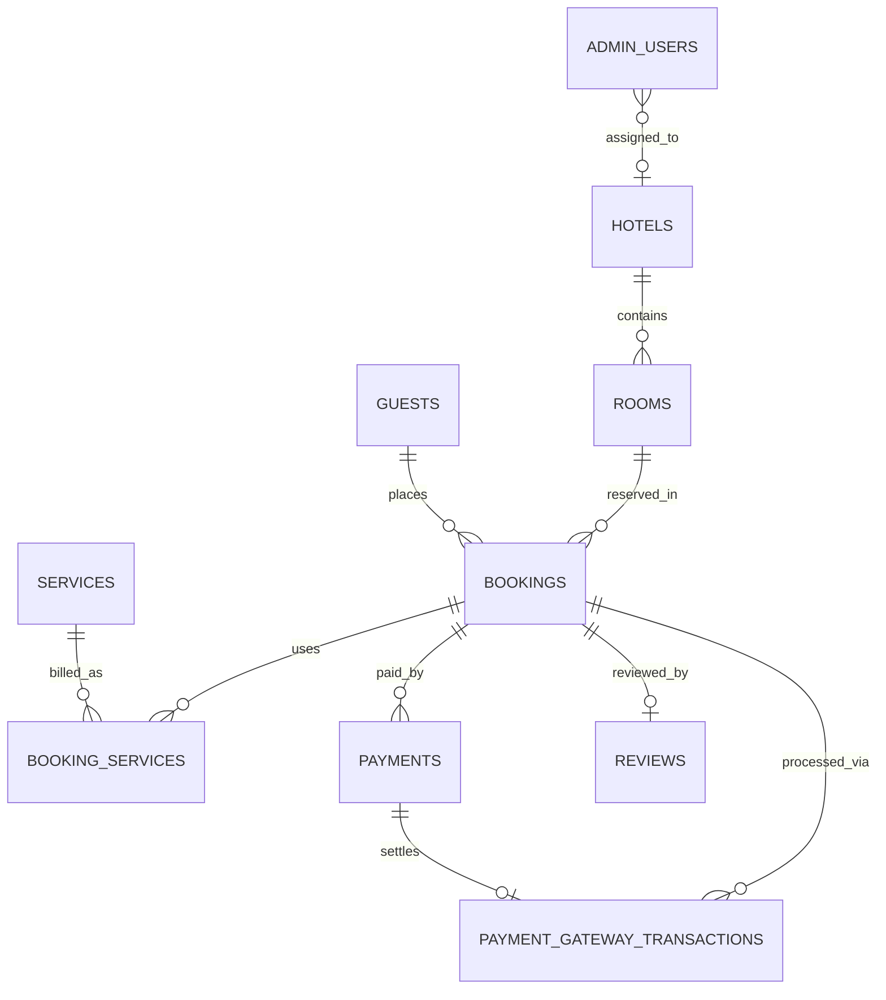

# Spotki Hotel Management API (Spring Boot 3)

[](https://github.com/vmhuong/Spotki-Hotel-API/actions/workflows/ci.yml)

RESTful Backend API for multi-branch hotel management, room availability search, booking & 50% deposit workflow, check-in/check-out with 8% VAT invoicing, loyalty points, housekeeping operations, and role-based access control (RBAC).

## Tech Stack

- **Language & Framework**: Java 21, Spring Boot 3.3.5
- **Data & Caching**: Spring Data JPA, Hibernate, PostgreSQL 16, Flyway, Redis Cache & Token Store, H2 (for isolated integration tests)
- **Security**: Spring Security 6, Stateless JWT + Refresh Token rotation (`jjwt`), Redis JWT logout blacklist, BCrypt, method-level RBAC (`@PreAuthorize`), IDOR & branch-scope protection, CORS
- **API Documentation**: SpringDoc OpenAPI 3 / Swagger UI
- **Testing & CI**: JUnit 5, Mockito, Spring Boot Test, MockMvc, GitHub Actions CI
- **Containerization**: Docker, Docker Compose (PostgreSQL 16 + Redis 7 + Spring Boot API)

## Architecture Highlights

```text
src/main/java/com/spotkihotel/
├── config/          # SecurityConfig (JWT + CORS), OpenApiConfig, CacheConfig, DataSeeder
├── controller/      # REST controllers (/api/v1/...)
├── dto/             # Request/Response DTOs with Jakarta Bean Validation
├── entity/          # JPA entities & domain enums
├── exception/       # GlobalExceptionHandler (@RestControllerAdvice)
├── job/             # Scheduled background maintenance jobs
├── repository/      # Spring Data JPA repositories, EntityGraphs & Pessimistic Locks
├── security/        # JwtService, JwtAuthenticationFilter, TokenStoreService (Redis), UserPrincipal
└── service/         # Transactional business logic & security logging
```

## Database ER Diagram



## Key Features

- **Dual Authentication, Refresh Token & Redis Blacklist**: Separate JWT login flows for customers (`ROLE_CUSTOMER`) and staff (`ROLE_ADMIN`, `ROLE_MANAGER`, `ROLE_RECEPTION`, `ROLE_ACCOUNTING`, `ROLE_HOUSEKEEPING`), refresh token rotation (`/api/v1/auth/refresh`), and Redis-backed access token revocation on logout (`/api/v1/auth/logout`).
- **Branch Scope & IDOR Protection**: Non-admin staff are restricted to their assigned `hotelId` across rooms, bookings, staff, payments, and housekeeping; customers can only view/edit/review their own bookings and invoices.
- **Room Search & Concurrency Control**: Date-range availability filtering excluding rooms with active `booked` or `checked_in` reservations, plus `PESSIMISTIC_WRITE` row locking during booking creation and customer edits to prevent double-booking race conditions.
- **Booking & Invoicing Lifecycle**:
  - Automatic 50% deposit calculation and payment recording on booking creation.
  - Extra guest surcharge calculation based on room capacity.
  - Customer self-service booking modification (limited to 1 edit while `booked`).
  - Check-in -> Room service charges -> Check-out with 8% VAT invoice calculation, loyalty point awarding (`Bronze`/`Silver`/`Gold`/`Platinum`), and automatic housekeeping queue trigger.
- **Scheduled Maintenance & Payment Webhook**: `@Scheduled` job to auto-cancel overdue bookings, plus sandbox payment gateway initiation and idempotent HMAC-SHA256 webhook callback.

## API Overview

| Module | Key Endpoints | Access |
| --- | --- | --- |
| **Auth** | `POST /api/v1/auth/customer/register`, `.../login`, `.../admin/login`, `.../refresh`, `.../logout` | Public / Authenticated |
| **Customer Profile** | `GET/PUT /api/v1/customers/me`, `PATCH /api/v1/customers/me/password` | `CUSTOMER` |
| **Catalog & Housekeeping** | `GET /api/v1/hotels`, `/rooms`, `/services`; `POST/PUT/PATCH/DELETE /api/v1/admin/**` | Public / Staff |
| **Bookings & Billing** | `POST /api/v1/bookings`, `GET /me`, `PUT /{id}/customer-edit`, `POST .../check-in`, `.../check-out`, `GET /{id}/invoice` | Public / Owner / Staff |
| **Payment Gateway** | `POST /api/v1/payments/gateway/initiate`, `POST /api/v1/payments/gateway/callback` | Authenticated / HMAC Webhook |
| **Staff, Guests & Reports** | `GET/POST/PATCH /api/v1/admin/staff`, `/guests`, `/payments`, `/reports/summary`, `/revenue`, `/top-rooms` | `ADMIN` / `MANAGER` / `ACCOUNTING` |

## Getting Started

### Option 1: Run with Docker Compose (Recommended)

```bash
docker compose up --build
```

- API Base URL (Docker): `http://localhost:8088` (configurable via `API_PORT`)
- Swagger UI (Docker): `http://localhost:8088/swagger-ui.html`

### Option 2: Run Locally with Maven Wrapper

1. Ensure PostgreSQL 16 is running on `localhost:5432` and Redis 7 on `localhost:6379` (configured via `.env.example` or environment variables).
2. Run tests (uses in-memory H2 in PostgreSQL mode + in-memory token/cache store, no external DB/Redis required):

```bash
./mvnw test
```

3. Start the application:

```bash
./mvnw spring-boot:run
```

## Sample Accounts (Seeded Automatically)

| Role | Endpoint | Username / Email | Password |
| --- | --- | --- | --- |
| Admin | `POST /api/v1/auth/admin/login` | `admin` | `Admin@12345` |
| Manager (Saigon) | `POST /api/v1/auth/admin/login` | `manager_sg` | `Manager@12345` |
| Reception (Saigon) | `POST /api/v1/auth/admin/login` | `reception_sg` | `Reception@12345` |
| Accounting (Saigon) | `POST /api/v1/auth/admin/login` | `accounting_sg` | `Accounting@12345` |
| Housekeeping (Saigon) | `POST /api/v1/auth/admin/login` | `housekeeping_sg` | `Housekeeping@12345` |
| Customer | `POST /api/v1/auth/customer/login` | `guest@spotkihotel.vn` | `Customer@12345` |
