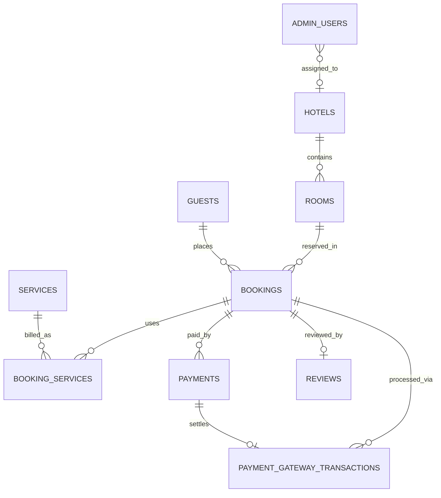

# Spotki Hotel Management System (Fullstack PMS & Booking Portal)

[](https://github.com/vmhuong/Spotki-Hotel-API/actions/workflows/ci.yml)

Full-stack multi-branch Hotel Management & PMS system featuring a React + TypeScript web application (`web/`) and a Spring Boot 3 REST API (`backend/`) with synchronized room availability, walk-in/booking management, POS billing, VietQR SePay webhook integration, loyalty points, housekeeping workflows, and branch-scoped RBAC.

## Tech Stack

- **Backend (`backend/`)**: Java 21, Spring Boot 3.3.5, Spring Data JPA, Hibernate, PostgreSQL 16, Flyway (`V1`–`V6`), Redis 7, Spring Security 6 (JWT + Refresh Token Rotation + Redis Blacklist + Rate Limiting), SpringDoc OpenAPI 3.
- **Frontend (`web/`)**: React, TypeScript, Vite, Tailwind CSS.
- **Testing & CI**: JUnit 5, Mockito, Spring Boot Test, MockMvc, Testcontainers (`postgres:16-alpine`), H2, GitHub Actions CI ([ci.yml](.github/workflows/ci.yml)).
- **Containerization**: Docker & Docker Compose (`postgres`, `redis`, `api`, `web`).

## Repository Structure

```text
SpotkiHotel/
├── backend/                     # Spring Boot 3 API + Flyway migrations + JUnit/Testcontainers suite
│   └── src/main/java/com/spotkihotel/
│       ├── config/              # SecurityConfig, OpenApiConfig, CacheConfig, DataSeeder
│       ├── controller/          # REST endpoints (/api/v1/...)
│       ├── dto/                 # Request/Response DTOs with validation
│       ├── entity/              # JPA entities & enums
│       ├── exception/           # GlobalExceptionHandler (@RestControllerAdvice)
│       ├── job/                 # Scheduled booking maintenance jobs
│       ├── repository/          # Spring Data JPA repositories & PESSIMISTIC_WRITE locks
│       ├── security/            # JwtService, JwtAuthenticationFilter, TokenStoreService, RateLimitFilter
│       └── service/             # Business logic, VietQR/SePay gateway, audit logging
├── web/                         # React + TypeScript + Vite SPA & PMS Admin workspace
├── docker-compose.yml           # Full 4-container local/VPS stack
└── .env.example                 # Environment variable template (copy to .env)
```

## Database ER Diagram



## Key Features

- **5-Role RBAC & Branch Isolation**:
  - `ROLE_ADMIN`: Full chain management, catalog, staff, reports, security audit logs.
  - `ROLE_MANAGER`: Branch operations (`Tổng quan`, `Đặt phòng`, `Phòng đang sử dụng`, `Dọn phòng`) and review moderation scoped to their managed branch (`hotelId`).
  - `ROLE_RECEPTION`: Front desk bookings & active occupied rooms.
  - `ROLE_ACCOUNTING`: Overview & payment transaction ledger.
  - `ROLE_HOUSEKEEPING`: Read-only view of occupied rooms + housekeeping queue updates.
- **Synchronized Front Desk & Booking Lifecycle**:
  - Separate flows for advance bookings (`booked`) and walk-in guests (immediate `checked_in` or hold), plus pre-check-in booking edits (`PUT /api/v1/admin/bookings/{id}`).
  - Real-time room schedule sync for nightly bookings and hourly stays with next-booking `12:00` turnover conflict warnings and `PESSIMISTIC_WRITE` row locking.
- **POS Bill Payment & VietQR (SePay) Webhook**:
  - Unified POS bill preview with room package details, check-in/out times, member tier/points, itemized service add/remove, and 8% VAT calculation.
  - Supports Cash, Card/POS, Loyalty Point redemption (verified via phone or identity number/CCCD, auto-refunded if removed before checkout), and dynamic **VietQR** generation.
  - Bank transfer transactions (`Chuyen khoan VietQR`) are locked against deletion in both UI and backend, and auto-updated via `POST /api/v1/payments/gateway/vietqr-webhook` (compatible with SePay `transferType: "in"` / `"out"`, idempotent by reference/gateway ID, protected via `VIETQR_WEBHOOK_API_KEY`).

## API Overview

| Module | Key Endpoints | Access |
| --- | --- | --- |
| **Auth** | `POST /api/v1/auth/customer/register`, `.../login`, `.../admin/login`, `.../refresh`, `.../logout` | Public / Authenticated |
| **Customer Portal** | `GET/PUT /api/v1/customers/me`, `PATCH /api/v1/customers/me/password`, `GET /bookings/me` | `CUSTOMER` |
| **Front Desk & Billing** | `POST /api/v1/bookings`, `POST /admin/bookings/walk-in`, `PUT /admin/bookings/{id}`, `POST .../check-in`, `.../check-out`, `GET/POST/DELETE .../services`, `.../payments`, `POST .../member` | Staff (Scoped) |
| **Payment Gateway & VietQR** | `POST /api/v1/payments/gateway/initiate`, `GET .../status/{appTransId}`, `POST .../callback`, `POST .../vietqr-webhook` | Authenticated / HMAC / SePay API Key |
| **Staff, Guests & Reports** | `GET /api/v1/admin/guests/lookup`, `GET/POST/PATCH /admin/staff`, `/admin/reports/summary`, `/admin/reports/revenue`, `/admin/payments`, `/admin/reviews`, `/admin/audit-logs` | Role & Branch Scoped |

## Getting Started

### Option 1: Docker Compose (Recommended for Local & VPS)

1. Copy `.env.example` to `.env` and fill in your values (never commit `.env`):

```bash
cp .env.example .env
```

Key VietQR / production variables in `.env`:
- `JWT_SECRET` & `DB_PASS` (change from demo defaults in production)
- `VIETQR_BANK_ID` (e.g. `MB`, `VCB`, `TCB`)
- `VIETQR_ACCOUNT_NO` & `VIETQR_ACCOUNT_NAME`
- `VIETQR_WEBHOOK_API_KEY` (shared API key sent by SePay in `Authorization: Apikey <key>`)

2. Build and start all 4 containers:

```bash
docker compose up -d --build
```

- **Web Portal & Admin UI**: `http://localhost:5173`
- **API Base URL**: `http://localhost:8088` (configurable via `API_PORT`)
- **Swagger UI**: `http://localhost:8088/swagger-ui.html`

### Connecting SePay VietQR Webhook

1. Expose your API over HTTPS (domain + reverse proxy on VPS, or Cloudflare Tunnel for local testing).
2. In SePay Dashboard -> **Tích hợp Webhooks** -> **+ Thêm Webhook**:
   - **URL**: `https://<your-domain>/api/v1/payments/gateway/vietqr-webhook`
   - **Condition**: Money in (`Tiền vào`)
   - **Auth**: API Key matching `VIETQR_WEBHOOK_API_KEY` in `.env`
   - **Content Type**: `application/json`

### Option 2: Run Backend & Frontend Locally

1. **Backend** (requires Java 21; tests run in-memory on H2 without external DB/Redis):

```bash
cd backend
./mvnw test
./mvnw spring-boot:run
```

2. **Frontend** (requires Node 22):

```bash
cd web
npm ci
npm run build
npm run dev
```

## Sample Accounts (Seeded Automatically)

| Role | Endpoint | Username / Email | Password |
| --- | --- | --- | --- |
| Admin | `POST /api/v1/auth/admin/login` | `admin` | `Admin@12345` |
| Manager (Saigon) | `POST /api/v1/auth/admin/login` | `manager_sg` | `Manager@12345` |
| Reception (Saigon) | `POST /api/v1/auth/admin/login` | `reception_sg` | `Reception@12345` |
| Accounting (Saigon) | `POST /api/v1/auth/admin/login` | `accounting_sg` | `Accounting@12345` |
| Housekeeping (Saigon) | `POST /api/v1/auth/admin/login` | `housekeeping_sg` | `Housekeeping@12345` |
| Customer | `POST /api/v1/auth/customer/login` | `guest@spotkihotel.vn` | `Customer@12345` |
